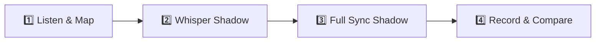

# 🎙️ American Accent Shadowing: "This Is Bad" (ThePrimeagen)

> [!abstract] **Video Overview & Source**
> - **Creator:** **[The PrimeTime / ThePrimeagen](https://www.youtube.com/@ThePrimeTimeagen)**
> - **Original Video:** [Watch on YouTube](https://www.youtube.com/watch?v=O905JwSgoi4)
> - **Field:** `Cybersecurity / Software Engineering / Internet Infrastructure`
> - **Target Accent:** Fast-paced Modern American Tech Vernacular, Sarcastic Inflection & Connected Speech

---

## 🎨 Color-Coded Shadowing Legend

Refer to this visual guide while shadowing. Match ThePrimeagen's rapid pacing, sarcastic inflection, and phonetic shortcuts:

| Category | Icon & Color Badge | Spoken Phenomenon | Purpose in Shadowing |
| :--- | :---: | :--- | :--- |
| **Slang & Street Talk** | <mark style="background-color: #FEF08A; color: #713F12; padding: 2px 6px; border-radius: 4px; font-weight: 600;">🟡 Yellow</mark> | Casual tech/gamer idioms, internet slang, informal swagger | *"side quest"*, *"sweet sweet API keys"*, *"who cares man"*, *"bada bing bada boom"* |
| **Native Expressions** | <mark style="background-color: #E9D5FF; color: #581C87; padding: 2px 6px; border-radius: 4px; font-weight: 600;">🟣 Lavender</mark> | Natural multi-word collocations, everyday conversational turns | *"under the hood"*, *"back in the day"*, *"in the clear"*, *"out of India"*, *"within no time"* |
| **Connected Speech** | <mark style="background-color: #BAE6FD; color: #0C4A6E; padding: 2px 6px; border-radius: 4px; font-weight: 600;">🔵 Sky Blue</mark> | Reductions, flap-T, contractions, dropped consonants | *"didja"*, *"gonna"*, *"wanna"*, *"kinda"*, flap-T (*[bedder]*), dropped g's (*[rootin']*) |
| **Rhythm & Fillers** | <mark style="background-color: #A7F3D0; color: #064E3B; padding: 2px 6px; border-radius: 4px; font-weight: 600;">🟢 Mint Green</mark> | Conversational glues, pacing markers, hesitation particles | *"like"*, *"you know"*, *"honestly"*, *"I mean"*, *"all right"*, *"right?"* |
| **Pitch & Emphasis** | <mark style="background-color: #FED7AA; color: #7C2D12; padding: 2px 6px; border-radius: 4px; font-weight: 600;">🟠 Peach Orange</mark> | Intonation peaks, sarcastic emphasis, dramatic punches | Pitch spikes on key words (*"FOUR"*, *"COMPLETELY BROKEN"*, *"TERRIFYING"*) |
| **ASR Error Fixes** | <mark style="background-color: #FECDD3; color: #881337; padding: 2px 6px; border-radius: 4px; font-weight: 600;">🔴 Light Rose</mark> | Corrected YouTube speech recognition mistakes | Fixes garbled audio, creator name (*"ThePrimeagen"*), tech names (*"Perl"*) |

---

## 👤 Creator Vocal Snapshot & Delivery Profile

> [!info] **Acoustic & Articulation Characteristics**
> - **Tempo & Cadence:** `~165 WPM` — *Rapid, animated, high-velocity stream-of-consciousness.*
> - **Signature Dialect Traits:**
>   - **Heavy Flap-T & D Assimilation:** *"did you"* becomes a rapid <mark style="background-color: #BAE6FD; color: #0C4A6E; padding: 1px 4px; border-radius: 3px;">didja</mark> `[dɪdʒə]`.
>   - **Sarcastic Pitch Swings:** Jumps an entire octave on punchlines (*"Super cool"*, *"Love it"*).
>   - **Colloquial Shortening:** Drops `-ing` consistently (*rooting* -> *rootin'*).
> - **Vibe:** Highly energetic, witty, unfiltered tech creator.

---

## 📝 Verbatim Transcript & Color-Coded Shadowing Drill

> [!tip] **Verbatim Accuracy Note**
> ThePrimeagen's spontaneous colloquial grammar and phrasing are preserved 100%. Only YouTube ASR mishearings have been corrected (marked in <mark style="background-color: #FECDD3; color: #881337; padding: 1px 4px; border-radius: 3px;">Rose</mark>).

### ⏱️ [00:00:00 - 00:00:33] — The Cold Open & Hook

Hey, <mark class="shadow-filler" style="background-color: #A7F3D0; color: #064E3B; padding: 2px 6px; border-radius: 4px;">so</mark> what is your favorite number between the number one and two to the 382nd? Oh, <mark class="shadow-reduction" style="background-color: #BAE6FD; color: #0C4A6E; padding: 2px 6px; border-radius: 4px;">did you</mark> just say <mark class="shadow-stress" style="background-color: #FED7AA; color: #7C2D12; padding: 2px 6px; border-radius: 4px;">FOUR</mark>? Nice. <mark class="shadow-filler" style="background-color: #A7F3D0; color: #064E3B; padding: 2px 6px; border-radius: 4px;">So</mark>, did eMudhra, a certificate authority, and now the internet is <mark class="shadow-stress" style="background-color: #FED7AA; color: #7C2D12; padding: 2px 6px; border-radius: 4px;">COMPLETELY BROKEN</mark>. <mark class="shadow-slang" style="background-color: #FEF08A; color: #713F12; padding: 2px 6px; border-radius: 4px;">Super cool</mark>. Do you see this right here? I just got <mark class="shadow-slang" style="background-color: #FEF08A; color: #713F12; padding: 2px 6px; border-radius: 4px;">man-in-the-middle attacked</mark> and I didn't even know it. Curl had <mark class="shadow-stress" style="background-color: #FED7AA; color: #7C2D12; padding: 2px 6px; border-radius: 4px;">NO IDEA</mark>. 

Also, <mark class="shadow-slang" style="background-color: #FEF08A; color: #713F12; padding: 2px 6px; border-radius: 4px;">fun little side quest</mark>, you can root your home speaker system. I just love the fact that even when someone talks about rooting their home speaker system, someone always comes at this question never fails: *"Hey, what font is that? Hey, what font are you doing?"* I know you just...

---

### ⏱️ [00:00:32 - 00:01:04] — The Streamer Rant & Chat Interactions

...really I know you're <mark class="shadow-reduction" style="background-color: #BAE6FD; color: #0C4A6E; padding: 2px 6px; border-radius: 4px;">rootin'</mark> and all that. It's <mark class="shadow-filler" style="background-color: #A7F3D0; color: #064E3B; padding: 2px 6px; border-radius: 4px;">like</mark>, <mark class="shadow-slang" style="background-color: #FEF08A; color: #713F12; padding: 2px 6px; border-radius: 4px;">who cares, man</mark>? What font is that? Love it. 

<mark class="shadow-filler" style="background-color: #A7F3D0; color: #064E3B; padding: 2px 6px; border-radius: 4px;">All right</mark>, so before we get started, a quick thank you from the sponsor. I have to say one of my favorite parts of this AI revolution is Grokbot, and that is because <mark class="shadow-stress" style="background-color: #FED7AA; color: #7C2D12; padding: 2px 6px; border-radius: 4px;">SO MANY</mark> little tedious tasks are now me just going, *"Hey, can you update my calendar with all my kids' upcoming soccer games for this tournament?"* Or, *"Hey, put milk on my list for things to pick up."* And with the ability to add custom MCPs, you could actually add any of your applications and be able to sync with it. Grokbot allows me to effectively control my life and just take out all the tedium.

---

### ⏱️ [00:01:33 - 00:02:40] — HTTP vs HTTPS Explained Casual-Style

See, when the internet got started, you used to <mark class="shadow-slang" style="background-color: #FEF08A; color: #713F12; padding: 2px 6px; border-radius: 4px;">jump on</mark> your computer and you would send these nice messages off to a server, and that server would be able to deliver you back all the cat videos and snowboardingvideos.com or rotten.com, whatever you were going to <mark class="shadow-idiom" style="background-color: #E9D5FF; color: #581C87; padding: 2px 6px; border-radius: 4px;">back in the day</mark>. 

You did all of this on HTTP. That's right, completely <mark class="shadow-idiom" style="background-color: #E9D5FF; color: #581C87; padding: 2px 6px; border-radius: 4px;">in the clear</mark>. If anybody could somehow intercept your communication in between you and the server, <mark class="shadow-correction" style="background-color: #FECDD3; color: #881337; padding: 2px 6px; border-radius: 4px;" title="ASR transcribed stutter 'they'd be be to see', corrected to audio match">they'd be able to see</mark> <mark class="shadow-stress" style="background-color: #FED7AA; color: #7C2D12; padding: 2px 6px; border-radius: 4px;">EXACTLY</mark> what you are doing. And this wasn't a problem until we started to want to send personal information. If you want to log on to your bank, you don't want anyone being able to see what you're typing in, <mark class="shadow-filler" style="background-color: #A7F3D0; color: #064E3B; padding: 2px 6px; border-radius: 4px;">right</mark>? 

Well, that's where HTTPS comes in... There isn't a cord that somehow you just put in and <mark class="shadow-slang" style="background-color: #FEF08A; color: #713F12; padding: 2px 6px; border-radius: 4px;">bada bing bada boom</mark> you are now talking to that server!

---

### ⏱️ [00:02:39 - 00:03:14] — "Under the Hood" & The MITM Threat

So you send your information to google.com. <mark class="shadow-idiom" style="background-color: #E9D5FF; color: #581C87; padding: 2px 6px; border-radius: 4px;">Underneath the hood</mark>, it actually sends it to the true google.com, gets that information back, and then sends it back to you. But what they get is all of your actual information. They could get your passwords, they could get whatever. This is known as a man-in-the-middle attack. Some people call it a <mark class="shadow-slang" style="background-color: #FEF08A; color: #713F12; padding: 2px 6px; border-radius: 4px;">mitm</mark>. Mitm. Mitm. Mitm. Mitm.

---

### ⏱️ [00:05:19 - 00:05:53] — The Cryptographic Absurdity ("It's FOUR")

Instead, it's <mark class="shadow-stress" style="background-color: #FED7AA; color: #7C2D12; padding: 2px 6px; border-radius: 4px;">FOUR</mark>. Actually, four! It is 47 bytes of zeros, then four. 

The actual timeline is starting on October 17th at around 4:30 in the afternoon. A researcher who goes by the name Wayne. <mark class="shadow-idiom" style="background-color: #E9D5FF; color: #581C87; padding: 2px 6px; border-radius: 4px;">By the way</mark>, every time I hear the name Wayne, I think of Mistborn era two. <mark class="shadow-slang" style="background-color: #FEF08A; color: #713F12; padding: 2px 6px; border-radius: 4px;">Big fan</mark>. Hopefully, Wayne's also a big fan. Ran a new key checking tool over certificates disclosed in the CCADB and found that eight EC keys broke. EC again, <mark class="shadow-correction" style="background-color: #FECDD3; color: #881337; padding: 2px 6px; border-radius: 4px;" title="ASR transcribed 'elliptical curves', corrected to standard crypto term 'elliptic curves'">elliptic curves</mark>. That is the P-384 I described up here. By 6:00, he sent off an email to Apple, Chrome, Microsoft, Mozilla, and eMudhra... <mark class="shadow-idiom" style="background-color: #E9D5FF; color: #581C87; padding: 2px 6px; border-radius: 4px;">Within almost no time</mark>, Chrome both confirmed it and updated Chrome.

---

### ⏱️ [00:06:21 - 00:07:27] — The Danger Zone for Developers

Which means that if they use this and they don't check for the revocation of the eMudhra P-384 <mark class="shadow-correction" style="background-color: #FECDD3; color: #881337; padding: 2px 6px; border-radius: 4px;" title="ASR transcribed 'Pearl', corrected to the programming language 'Perl'">Perl</mark>, Ruby, OpenSSL... well, <mark class="shadow-idiom" style="background-color: #E9D5FF; color: #581C87; padding: 2px 6px; border-radius: 4px;">guess what</mark>? <mark class="shadow-reduction" style="background-color: #BAE6FD; color: #0C4A6E; padding: 2px 6px; border-radius: 4px;">You're gonna</mark> get man in the middle. Curl could get man in the middle... 

That means if I npm installed, theoretically, I could be getting code that might not be that good for my system to run, and I would accidentally run it, and accidentally there goes all my <mark class="shadow-slang" style="background-color: #FEF08A; color: #713F12; padding: 2px 6px; border-radius: 4px;">sweet sweet API keys</mark>, and then a <mark class="shadow-correction" style="background-color: #FECDD3; color: #881337; padding: 2px 6px; border-radius: 4px;" title="ASR transcribed 'distilling attack', corrected to audio match 'data-stealing attack'">data-stealing attack</mark>, and I get banned!

---

### ⏱️ [00:07:57 - 00:08:32] — Outro & Closing Sign-Off

<mark class="shadow-filler" style="background-color: #A7F3D0; color: #064E3B; padding: 2px 6px; border-radius: 4px;">Like</mark>, <mark class="shadow-filler" style="background-color: #A7F3D0; color: #064E3B; padding: 2px 6px; border-radius: 4px;">you know</mark>, go sniffing around in some devices. Good luck. Have fun. <mark class="shadow-idiom" style="background-color: #E9D5FF; color: #581C87; padding: 2px 6px; border-radius: 4px;">Make sure</mark> you update <mark class="shadow-idiom" style="background-color: #E9D5FF; color: #581C87; padding: 2px 6px; border-radius: 4px;">by the way</mark>. <mark class="shadow-filler" style="background-color: #A7F3D0; color: #064E3B; padding: 2px 6px; border-radius: 4px;">Like</mark>, you <mark class="shadow-stress" style="background-color: #FED7AA; color: #7C2D12; padding: 2px 6px; border-radius: 4px;">REALLY REALLY REALLY REALLY REALLY</mark> should go updating. 

The name is <mark class="shadow-correction" style="background-color: #FECDD3; color: #881337; padding: 2px 6px; border-radius: 4px;" title="ASR transcribed 'the primogen', corrected to creator handle 'ThePrimeagen'">ThePrimeagen</mark>. Look at me. I'm the Google now. You get to do this. Also a little bit <mark class="shadow-stress" style="background-color: #FED7AA; color: #7C2D12; padding: 2px 6px; border-radius: 4px;">TERRIFYING</mark> that our entire internet was held up for over a year by just the number four.

---

## 🔬 Linguistic Breakdown & Expression Matrix

### 1. 🟡 American Slang & Modern Tech Vernacular
| Expression | Spoken Meaning in Context | Primeagen's Delivery & Vibe |
| :--- | :--- | :--- |
| **"fun little side quest"** | A secondary, entertaining distraction away from the main task (gamer slang). | Casual, ironic, playful. |
| **"bada bing bada boom"** | Effortlessly and instantaneously happening in a snap (classic colloquial idiom). | Fast, rhythmic, Italian-American street flavor. |
| **"sweet sweet API keys"** | Prized, sensitive digital credentials (humorous affectionate repetition). | Sarcastic mourning tone. |
| **"who cares, man?"** | Dismissive reaction to trivial chat questions. | High pitch rising tone, peak exasperation. |
| **"jump on (your computer)"** | Log on, open up, or sit down to work casually. | Natural American digital phrasing. |

### 2. 🟣 Native Collocations & Everyday Idioms
| Native Phrase | Textbook Equivalent | Why Native Speakers Use It |
| :--- | :--- | :--- |
| **"underneath the hood"** | *"Internally / deep inside the system architecture"* | Standard automotive metaphor universally used in tech talks. |
| **"in the clear"** | *"Unencrypted and exposed to the public"* | Military/communications native idiom. |
| **"back in the day"** | *"In the early era of the internet"* | Universal native idiom for nostalgic reference. |
| **"within almost no time"** | *"Very rapidly / nearly instantaneously"* | Idiomatic duration expression. |

### 3. 🔵 Connected Speech & Phonetic Reductions
| Written Words | Spoken Sound / IPA | Phonetic Phenomenon | Mouth & Tongue Mechanics |
| :--- | :--- | :--- | :--- |
| `did you` | `didja` (`/ˈdɪdʒə/`) | Palatalization assimilation | The alveolar `/d/` and glide `/j/` fuse into an affricate `[dʒ]`. |
| `going to` | `gonna` (`/ˈɡʌnə/`) | Fast speech contraction | Squash unstressed vowel into schwa `/ə/`. |
| `rooting` | `rootin'` (`/ˈruːtɪn/`) | Dropped velar nasal | Tongue strikes the alveolar ridge (`/n/`) instead of the soft palate (`/ŋ/`). |
| `kind of` | `kinda` (`/ˈkaɪndə/`) | Preposition reduction | Unstressed *of* reduces to `/ə/` and fuses with *kind*. |

### 4. 🔴 ASR Error Correction Log
| Timestamp | Raw YouTube Auto-Caption | Primeagen's Actual Spoken Audio | Contextual Reason for Correction |
| :--- | :--- | :--- | :--- |
| `[00:01:42]` | `they'd be be to see` | **`they'd be able to see`** | ASR dropped syllable from rapid audio delivery. |
| `[00:05:42]` | `elliptical curves` | **`elliptic curves`** | Industry-standard cryptographic terminology (ECC). |
| `[00:06:28]` | `Pearl` | **`Perl`** | Homophone confusion; referring to the Perl programming language. |
| `[00:07:22]` | `distilling attack` | **`data-stealing attack`** | Acoustic blur caused by speaker's rapid articulation. |
| `[00:08:12]` | `the primogen` | **`ThePrimeagen`** | Speech-to-text failed on the creator's custom brand handle. |

---

## 🎯 4-Step Action Routine for Practicing This Video

1. **Step 1: Active Listen (No Talking):** Focus on Primeagen's rapid <mark style="background-color: #FED7AA; color: #7C2D12; padding: 1px 4px; border-radius: 3px;">Orange</mark> pitch spikes on sarcastic punchlines (*"FOUR"*, *"COMPLETELY BROKEN"*). Notice how his voice goes up an octave.
2. **Step 2: Whisper Shadow (0.85x Speed):** Put the video on 0.85x speed on YouTube. Whisper along without vocal volume to match his rapid tongue speed on *"didja"* and *"bada bing bada boom"*.
3. **Step 3: Full Synchronous Shadow (1.0x Speed):** Speak out loud *at the exact same second* as Primeagen. Match his sarcastic swagger, fast pauses, and energetic tech cadence.
4. **Step 4: Record & Self-Audit:** Record a 30-second take of the *"Cold Open"* segment on your phone or computer. Compare your energy, flap-Ts, and pitch rises to the original video.
