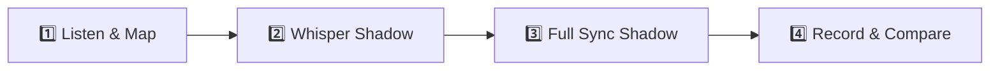

# 🎙️ American Accent Shadowing: Python for Beginners

> [!abstract] **Video Overview & Source**
> - **Creator:** **[Programming with Mosh](https://www.youtube.com/@programmingwithmosh)**
> - **Original Video:** [Watch on YouTube](https://www.youtube.com/watch?v=kqtD5dpn9C8)
> - **Field:** `Technology / Software Engineering / AI`
> - **Dialect Focus:** Modern General American Conversational Tech Cadence, Instructional Rhythm & Connected Speech

---

## 🎨 Color-Coded Shadowing Legend

Refer to this visual guide while shadowing. Match the creator's rhythm and mouth movements based on each category:

| Category | Icon & Color Swatch | What It Signals in Speech | How to Deliver It |
| :--- | :---: | :--- | :--- |
| **Slang & Street Talk** | <mark style="background-color: #FEF08A; color: #713F12; padding: 2px 6px; border-radius: 4px; font-weight: 600;">🟡 Yellow</mark> | Casual idioms, modern internet/street vocabulary, informal tech slang | Deliver relaxed, confident, low-stress |
| **Native Expressions** | <mark style="background-color: #E9D5FF; color: #581C87; padding: 2px 6px; border-radius: 4px; font-weight: 600;">🟣 Lavender</mark> | Natural multi-word collocations, everyday business/podcast phrases | Pronounce as a single linked chunk |
| **Connected Speech** | <mark style="background-color: #BAE6FD; color: #0C4A6E; padding: 2px 6px; border-radius: 4px; font-weight: 600;">🔵 Sky Blue</mark> | Phonetic reductions, contractions, flap-T, dropped consonants | Blend words together, soften unstressed syllables |
| **Rhythm & Fillers** | <mark style="background-color: #A7F3D0; color: #064E3B; padding: 2px 6px; border-radius: 4px; font-weight: 600;">🟢 Mint Green</mark> | Natural conversational glues, pacing markers, hesitations | Lower pitch, lower volume, bridge between thoughts |
| **Pitch & Emphasis** | <mark style="background-color: #FED7AA; color: #7C2D12; padding: 2px 6px; border-radius: 4px; font-weight: 600;">🟠 Peach Orange</mark> | Intonation peaks, contrastive word stress, dramatic punches | Raise vocal pitch 3-5 semitones, elongate vowel |
| **ASR Error Fixes** | <mark style="background-color: #FECDD3; color: #881337; padding: 2px 6px; border-radius: 4px; font-weight: 600;">🔴 Rose</mark> | Corrected YouTube speech recognition mistakes (faithful to audio) | Exact word the creator actually articulated |

---

## 👤 Creator Vocal Snapshot & Delivery Profile

> [!info] **Acoustic & Articulation Characteristics**
> - **Tempo & Cadence:** `~135 WPM` — *Clean, measured, articulate pacing. Ideal for baseline accent training and vowel clarity.*
> - **Key Phonetic Quirks:** 
>   - Flap-T across word boundaries: *"what you can do with it"* -> `[wʌdʒə kən du wɪðɪt]`.
>   - Consistent reduction of *"going to"* into *"gonna"* and *"want to"* into *"wanna"*.
>   - Pitch rises on instructional setup words (*"Now"*, *"All right"*, *"In this video"*).
> - **Vibe:** Approachable, authoritative, mentor-like.

---

## 📝 Verbatim Transcript & Color-Coded Shadowing Drill

> [!tip] **Verbatim Accuracy Note**
> This transcript preserves Mosh's exact spontaneous speech patterns, contractions, and colloquialisms. Only YouTube ASR mishearings have been corrected (e.g. caption wrote "carrot", corrected to "caret").

### ⏱️ [00:00:02 - 00:00:45] — Opening Hook & Value Proposition

In this Python tutorial, <mark class="shadow-reduction" style="background-color: #BAE6FD; color: #0C4A6E; padding: 2px 6px; border-radius: 4px;">you're gonna</mark> learn <mark class="shadow-stress" style="background-color: #FED7AA; color: #7C2D12; padding: 2px 6px; border-radius: 4px;">EVERYTHING</mark> you need to know to start programming in Python. If you <mark class="shadow-reduction" style="background-color: #BAE6FD; color: #0C4A6E; padding: 2px 6px; border-radius: 4px;">wanna</mark> learn Python programming for data science, machine learning, or web development, this Python tutorial is the <mark class="shadow-stress" style="background-color: #FED7AA; color: #7C2D12; padding: 2px 6px; border-radius: 4px;">PERFECT</mark> place to learn Python. You don't need any prior knowledge in Python or programming in general. I'm <mark class="shadow-reduction" style="background-color: #BAE6FD; color: #0C4A6E; padding: 2px 6px; border-radius: 4px;">gonna</mark> teach you everything <mark class="shadow-idiom" style="background-color: #E9D5FF; color: #581C87; padding: 2px 6px; border-radius: 4px;">from scratch</mark>. I'm Mosh Hamedani, and I've taught millions of people how to code through this channel. If you're new here, <mark class="shadow-idiom" style="background-color: #E9D5FF; color: #581C87; padding: 2px 6px; border-radius: 4px;">make sure</mark> to subscribe as I upload new videos every week. <mark class="shadow-filler" style="background-color: #A7F3D0; color: #064E3B; padding: 2px 6px; border-radius: 4px;">Now</mark>, let's <mark class="shadow-slang" style="background-color: #FEF08A; color: #713F12; padding: 2px 6px; border-radius: 4px;">jump in</mark> and get started. 

<mark class="shadow-filler" style="background-color: #A7F3D0; color: #064E3B; padding: 2px 6px; border-radius: 4px;">All right</mark>, before we get started, <mark class="shadow-reduction" style="background-color: #BAE6FD; color: #0C4A6E; padding: 2px 6px; border-radius: 4px;">lemme</mark> give you some ideas about what you can do with Python. That's a very common question. Python is a multi-purpose programming language, so you can use it for a variety of different tasks. You can use Python for machine learning and AI. <mark class="shadow-idiom" style="background-color: #E9D5FF; color: #581C87; padding: 2px 6px; border-radius: 4px;">In fact</mark>, Python is the <mark class="shadow-stress" style="background-color: #FED7AA; color: #7C2D12; padding: 2px 6px; border-radius: 4px;">NUMBER ONE</mark> language for machine learning and data science projects.

---

### ⏱️ [00:01:23 - 00:02:08] — Setup & Quick Action

<mark class="shadow-filler" style="background-color: #A7F3D0; color: #064E3B; padding: 2px 6px; border-radius: 4px;">All right</mark>, the first thing I want you to do is to <mark class="shadow-idiom" style="background-color: #E9D5FF; color: #581C87; padding: 2px 6px; border-radius: 4px;">head over to</mark> python.org to download the latest version of Python. <mark class="shadow-filler" style="background-color: #A7F3D0; color: #064E3B; padding: 2px 6px; border-radius: 4px;">So</mark>, you go to downloads and select the latest version of Python. Here in your downloads folder, you should see this package. Simply double-click it. <mark class="shadow-reduction" style="background-color: #BAE6FD; color: #0C4A6E; padding: 2px 6px; border-radius: 4px;">You're gonna</mark> see this Python installer. If you're on Windows, you will see this checkbox over here: add Python to path. <mark class="shadow-idiom" style="background-color: #E9D5FF; color: #581C87; padding: 2px 6px; border-radius: 4px;">Make sure</mark> to check it. It's <mark class="shadow-stress" style="background-color: #FED7AA; color: #7C2D12; padding: 2px 6px; border-radius: 4px;">REALLY</mark> important. Otherwise, <mark class="shadow-reduction" style="background-color: #BAE6FD; color: #0C4A6E; padding: 2px 6px; border-radius: 4px;">you're not gonna</mark> be able to follow this tutorial. Simply click on continue again <mark class="shadow-idiom" style="background-color: #E9D5FF; color: #581C87; padding: 2px 6px; border-radius: 4px;">one more time</mark>, I agree with the terms, and install the latest version of Python. Now, here you need to enter the username and password of your computer. <mark class="shadow-filler" style="background-color: #A7F3D0; color: #064E3B; padding: 2px 6px; border-radius: 4px;">So</mark>, let's do that <mark class="shadow-slang" style="background-color: #FEF08A; color: #713F12; padding: 2px 6px; border-radius: 4px;">real quick</mark>.

---

### ⏱️ [00:09:39 - 00:10:22] — Interactive Input & Fixed ASR Mistake

We get this message. <mark class="shadow-filler" style="background-color: #A7F3D0; color: #064E3B; padding: 2px 6px; border-radius: 4px;">Now</mark>, we have to enter a value. <mark class="shadow-filler" style="background-color: #A7F3D0; color: #064E3B; padding: 2px 6px; border-radius: 4px;">So</mark>, we click over here. Now, you can see that the <mark class="shadow-correction" style="background-color: #FECDD3; color: #881337; padding: 2px 6px; border-radius: 4px; border-bottom: 2px dashed #881337;" title="YouTube ASR captioned 'carrot', corrected to 'caret'">caret</mark> is separated from the question mark. This is because of the whitespace that we added over here. <mark class="shadow-filler" style="background-color: #A7F3D0; color: #064E3B; padding: 2px 6px; border-radius: 4px;">So</mark>, now we have to type a value. Let's say John. When we press enter, this function will return the value that we entered in the terminal window. <mark class="shadow-filler" style="background-color: #A7F3D0; color: #064E3B; padding: 2px 6px; border-radius: 4px;">So</mark>, we can get that value and store it in a variable. <mark class="shadow-filler" style="background-color: #A7F3D0; color: #064E3B; padding: 2px 6px; border-radius: 4px;">So</mark>, let's declare a variable called name and set it to the return value of the input function.

---

## 🔬 Linguistic Breakdown & Expression Matrix

### 1. 🟡 Slang & Modern Informal Expressions
| Expression | Spoken Meaning | Creator's Delivery |
| :--- | :--- | :--- |
| **"jump in"** | Start immediately without wasting time. | Energized, upbeat call to action. |
| **"real quick"** | Fast, casually, taking only a brief moment. | Delivered quickly as a single linked chunk `[ri-əl-kwɪk]`. |

### 2. 🟣 Native Collocations & Everyday Idioms
| Native Phrase | Textbook Literal Equivalent | Why Native Speakers Use It |
| :--- | :--- | :--- |
| **"from scratch"** | *"From the very beginning without prior assets"* | Universal native idiom for starting with zero background. |
| **"make sure"** | *"Verify or ensure"* | Conversational standard; sounds far more natural than *"ensure"*. |
| **"head over to"** | *"Navigate to or visit"* | Casual digital navigation phrase common in YouTube tech tutorials. |

### 3. 🔵 Connected Speech & Phonetic Reductions
| Written Words | Spoken Sound / IPA | Phonetic Phenomenon | Tongue / Mouth Position |
| :--- | :--- | :--- | :--- |
| `going to` | `gonna` (`/ˈɡʌnə/`) | Fast speech contraction | Tongue moves from velar `/ɡ/` to neutral schwa `/ə/`. |
| `want to` | `wanna` (`/ˈwɑnə/`) | Unstressed reduction | Lips round slightly on `/w/` and drop into `/nə/`. |
| `let me` | `lemme` (`/ˈlɛmi/`) | Consonant assimilation | The `/t/` dissolves into the bilabial `/m/`. |
| `you are not going to` | `you're not gonna` | Multiple contractions | Stressed negation on *"NOT"*, fast slide into *"gonna"*. |

### 4. 🔴 ASR Error Correction Log
| Timestamp | YouTube Auto-Caption (Wrong) | Creator's Actual Audio (Corrected) | Reason for Correction |
| :--- | :--- | :--- | :--- |
| `[00:09:47]` | `carrot` (the vegetable) | **`caret`** (blinking cursor `^`) | Homophone confusion by speech recognition engine in programming context. |

---

## 🎯 4-Step Action Routine for Practicing

1. **Step 1: Active Listen (No Talking):** Focus your ears strictly on Mosh's <mark style="background-color: #FED7AA; color: #7C2D12; padding: 1px 4px; border-radius: 3px;">Orange</mark> pitch peaks (*EVERYTHING*, *PERFECT*, *REALLY*) and <mark style="background-color: #BAE6FD; color: #0C4A6E; padding: 1px 4px; border-radius: 3px;">Blue</mark> reductions (*gonna*, *wanna*, *lemme*).
2. **Step 2: Whisper Shadow (0.85x - 1.0x Speed):** Mumble along silently or in a whisper. Match the exact tongue speed without straining vocal cords.
3. **Step 3: Full Vocal Shadow (Simultaneous):** Speak out loud *at the exact same second* as the video. Match his warm, authoritative tone and conversational cadence.
4. **Step 4: Record & Self-Audit:** Record a 30-second take using your phone or Obsidian Audio recorder. Check if your flap-T and reductions sound identical.
