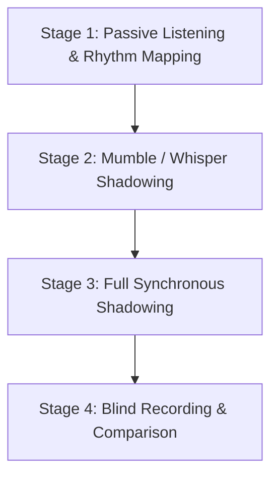

# 🗣️ American Accent Phonetics & Shadowing Mechanics

Mastering an authentic American accent requires retraining your mouth muscle memory, vocal tract posture, and rhythm control. Use this guide alongside your Obsidian shadowing notes.

---

## 1. The Core American Vocal Posture (Vocal Tract Settings)

1. **Low, Relaxed Tongue Body:**
   - In General American English, the tongue body sits flat and pulled slightly back toward the pharynx. The tip rests gently behind the lower front teeth when at rest.
2. **Open Jaw & Throat:**
   - Americans drop their jaw more than British or Middle Eastern speakers on open vowels like `/æ/` (*cat*, *trap*) and `/ɑː/` (*father*, *hot*).
3. **Resonance in the Chest & Lower Pharynx:**
   - Speak with a grounded, chest-resonant voice rather than a nasal or head voice.
4. **The Rhotic "R" (`/ɹ/` or `[ɚ]` / `[ɝ]`):**
   - American R is voiced strongly. Keep the tip of the tongue curled slightly back (retroflex) or bunch the back of the tongue toward the molars without touching the roof of the mouth.

---

## 2. The 5 Essential American Connected Speech Rules

### Rule 1: The Flap T / D (`[ɾ]`)
- **Condition:** Occurs when `/t/` or `/d/` appears between two vowels where the second vowel is unstressed.
- **Examples:**
  - *water* -> `[wah-der]`
  - *better* -> `[beh-der]`
  - *city* -> `[sih-dee]`
  - *get out* -> `[geh-dout]`
  - *not at all* -> `[nah-tə-tall]`
- **Action:** Tap the tip of your tongue against the roof of your mouth once quickly, like saying a very soft "d".

### Rule 2: The Glottal Stop (`[ʔ]`)
- **Condition:** Occurs before `/n/` or word-finally before a consonant.
- **Examples:**
  - *button* -> `[buh-ʔ-n]`
  - *fitness* -> `[fih-ʔ-niss]`
  - *curtain* -> `[cur-ʔ-n]`
  - *right now* -> `[rai-ʔ now]`
- **Action:** Stop the air completely at your vocal cords for a split second, then release into the nasal `/n/`.

### Rule 3: Natural Contractions & Reductions
American speech blends high-frequency function words into standard reductions:

| Written Form | Spoken Reduction | IPA / Sound | Example Sentence |
| :--- | :--- | :--- | :--- |
| **going to** | *gonna* | `/ˈɡʌnə/` | *"I'm gonna head out now."* |
| **want to** | *wanna* | `/ˈwɑnə/` | *"Do you wanna grab coffee?"* |
| **got to** | *gotta* | `/ˈɡɑtə/` | *"We gotta wrap this up."* |
| **let me** | *lemme* | `/ˈlɛmi/` | *"Lemme check that real quick."* |
| **give me** | *gimme* | `/ˈɡɪmi/` | *"Gimme two seconds."* |
| **could have** | *coulda* | `/ˈkʊdə/` | *"You coulda told me sooner."* |
| **should have** | *shoulda* | `/ˈʃʊdə/` | *"I shoulda seen that coming."* |
| **what are you** | *whaddya* | `/ˈwʌdjə/` | *"Whaddya think about this?"* |
| **kind of** | *kinda* | `/ˈkaɪndə/` | *"It's kinda tricky to explain."* |
| **out of** | *outta* | `/ˈaʊtə/` | *"Let's get outta here."* |

### Rule 4: Dropped "G" in `-ing` (`/ɪn/`)
- In casual American speech, content creators almost universally drop the velar nasal `/ŋ/` in favor of an alveolar `/n/`:
  - *running* -> *runnin'*
  - *doing* -> *doin'*
  - *making* -> *makin'*
  - *thinking* -> *thinkin'*

### Rule 5: Vowel Reduction to Schwa (`/ə/`)
- Function words (*to, at, for, of, and, can*) lose their full vowel and reduce to `/ə/`:
  - *"cup of tea"* -> `[cuppə tea]`
  - *"for you"* -> `[fər you]`
  - *"can you do it"* -> `[kən you do it]`

---

## 3. The 4-Stage Shadowing Protocol for Video Training

Follow this exact four-stage sequence for every 30-45 second block in your Obsidian note:

1. **Stage 1 — Passive Listening & Rhythm Mapping (1x - 2x):**
   - Play the 30-second video clip. Do not speak.
   - Tap your finger on the desk to the rhythm of the stressed words (orange highlights). Notice where the creator pauses and catches their breath.
2. **Stage 2 — Mumble / Whisper Shadowing (2x - 3x):**
   - Play the audio at normal or 0.85x speed.
   - Whisper the words along with the creator, matching the cadence and reductions (blue highlights) without projecting your full voice.
3. **Stage 3 — Full Synchronous Shadowing (3x - 5x):**
   - Speak out loud simultaneously with the creator.
   - Match their pitch rises, enthusiasm, conversational glues (green highlights), and slang swagger (yellow highlights).
4. **Stage 4 — Blind Recording & Comparison (1x):**
   - Mute the video or record yourself delivering the exact same 30 seconds into Voice Memos or Obsidian Audio Recorder.
   - Play back your audio side-by-side with the creator's clip. Spot discrepancies in vowel length, flap Ts, and pauses.
