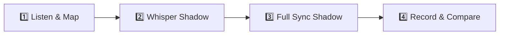

# 🎙️ American Accent Shadowing: {{VIDEO_TITLE}}

> [!abstract] **Video Overview & Source**
> - **Creator:** **[{{CREATOR_NAME}}]({{CREATOR_CHANNEL_URL}})**
> - **Original Video:** [Watch on YouTube]({{VIDEO_URL}})
> - **Primary Field:** `{{CONTENT_FIELD}}` *(Tech / AI / Finance / Podcasts / Self-Improvement)*
> - **Dialect Focus:** General American Conversational Cadence, Connected Speech & Casual Slang

---

## 🎨 Color-Coded Shadowing Legend

Refer to this visual guide while shadowing. Match the creator's rhythm and mouth movements based on each category:

| Category | Icon & Color Swatch | What It Signals in Speech | How to Deliver It |
| :--- | :---: | :--- | :--- |
| **Slang & Street Talk** | <mark style="background-color: #FEF08A; color: #713F12; padding: 2px 6px; border-radius: 4px; font-weight: 600;">🟡 Yellow</mark> | Casual idioms, modern internet/street vocabulary, youth slang | Deliver relaxed, confident, low-stress |
| **Native Expressions** | <mark style="background-color: #E9D5FF; color: #581C87; padding: 2px 6px; border-radius: 4px; font-weight: 600;">🟣 Lavender</mark> | Natural multi-word collocations, everyday business/podcast phrases | Pronounce as a single linked chunk |
| **Connected Speech** | <mark style="background-color: #BAE6FD; color: #0C4A6E; padding: 2px 6px; border-radius: 4px; font-weight: 600;">🔵 Sky Blue</mark> | Phonetic reductions, contractions, flap-T, dropped consonants | Blend words together, soften unstressed syllables |
| **Rhythm & Fillers** | <mark style="background-color: #A7F3D0; color: #064E3B; padding: 2px 6px; border-radius: 4px; font-weight: 600;">🟢 Mint Green</mark> | Natural conversational glues, pacing markers, hesitations | Lower pitch, lower volume, bridge between thoughts |
| **Pitch & Emphasis** | <mark style="background-color: #FED7AA; color: #7C2D12; padding: 2px 6px; border-radius: 4px; font-weight: 600;">🟠 Peach Orange</mark> | Intonation peaks, contrastive word stress, dramatic punches | Raise vocal pitch 3-5 semitones, elongate vowel |
| **ASR Error Fixes** | <mark style="background-color: #FECDD3; color: #881337; padding: 2px 6px; border-radius: 4px; font-weight: 600;">🔴 Rose</mark> | Corrected YouTube speech recognition mistakes (faithful to audio) | Exact word the creator actually articulated |

---

## 👤 Creator Vocal Snapshot & Delivery Profile

> [!info] **Acoustic & Articulation Characteristics**
> - **Tempo & Cadence:** `~{{PACING_WPM}} WPM` — *Steady, clear conversational pacing with natural micro-pauses.*
> - **Phonetic Traits:** Frequent flap-T substitution (`better` -> `[bedder]`), reduced function words, dropped `-ing` endings.
> - **Tone & Energy:** Warm, direct-to-camera engaging style.

---

## 📝 Verbatim Transcript & Color-Coded Shadowing Drill

> [!tip] **Verbatim Accuracy Note**
> This transcript preserves the creator's exact spontaneous speech patterns, contractions, and colloquialisms. Only YouTube ASR mishearings have been corrected (marked in <mark style="background-color: #FECDD3; color: #881337; padding: 1px 4px; border-radius: 3px;">Rose</mark>).

### ⏱️ [00:00 - 00:35] — Hook & Opening Thoughts

<mark class="shadow-filler" style="background-color: #A7F3D0; color: #064E3B; padding: 2px 6px; border-radius: 4px;">All right</mark>, in this tutorial, <mark class="shadow-reduction" style="background-color: #BAE6FD; color: #0C4A6E; padding: 2px 6px; border-radius: 4px;">you're gonna</mark> learn <mark class="shadow-stress" style="background-color: #FED7AA; color: #7C2D12; padding: 2px 6px; border-radius: 4px;">EVERYTHING</mark> you need to know to <mark class="shadow-idiom" style="background-color: #E9D5FF; color: #581C87; padding: 2px 6px; border-radius: 4px;">hit the ground running</mark>. <mark class="shadow-filler" style="background-color: #A7F3D0; color: #064E3B; padding: 2px 6px; border-radius: 4px;">I mean</mark>, if you've been sitting on the fence, this is <mark class="shadow-slang" style="background-color: #FEF08A; color: #713F12; padding: 2px 6px; border-radius: 4px;">hands down</mark> the <mark class="shadow-stress" style="background-color: #FED7AA; color: #7C2D12; padding: 2px 6px; border-radius: 4px;">BEST</mark> place to start. Now, <mark class="shadow-reduction" style="background-color: #BAE6FD; color: #0C4A6E; padding: 2px 6px; border-radius: 4px;">lemme</mark> show you how this <mark class="shadow-correction" style="background-color: #FECDD3; color: #881337; padding: 2px 6px; border-radius: 4px;" title="Corrected transcription error">caret</mark> is placed.

---

## 🔬 Linguistic Breakdown & Expression Matrix

### 1. 🟡 Slang & Modern Expressions
| Expression | Spoken Meaning | Real-World Context | Delivery & Vibe |
| :--- | :--- | :--- | :--- |
| `{{EXPRESSION_1}}` | {{MEANING_1}} | {{CONTEXT_1}} | Relaxed, confident |

### 2. 🟣 Native Collocations & Everyday Idioms
| Native Phrase | Textbook Equivalent | Why Native Speakers Use It |
| :--- | :--- | :--- |
| `{{IDIOM_1}}` | {{TEXTBOOK_ALT_1}} | Natural conversational fluency and rhythm |

### 3. 🔵 Connected Speech Reductions & Sound Merges
| Written Text | Spoken Phonetics / IPA | Reduction Mechanism | Mouth & Tongue Action |
| :--- | :--- | :--- | :--- |
| `going to` | `gonna` (`/ˈɡʌnə/`) | Fast speech contraction | Squash vowel into schwa `/ə/` |
| `let me` | `lemme` (`/ˈlɛmi/`) | Consonant assimilation | Soften /t/ into bilabial /m/ |

---

## 🎯 4-Step Action Routine for Practicing

1. **Step 1: Active Listen (No Talking):** Focus your ears strictly on the <mark style="background-color: #FED7AA; color: #7C2D12; padding: 1px 4px; border-radius: 3px;">Orange</mark> pitch peaks and <mark style="background-color: #BAE6FD; color: #0C4A6E; padding: 1px 4px; border-radius: 3px;">Blue</mark> word connections.
2. **Step 2: Whisper Shadow (0.85x - 1.0x Speed):** Mumble along silently or in a whisper. Match the creator's exact mouth posture and tongue speed.
3. **Step 3: Full Vocal Shadow (Simultaneous):** Speak out loud *at the exact same second* as the creator. Match their volume, enthusiasm, and pitch curves.
4. **Step 4: Record & Self-Audit:** Record a 30-second take on your phone or computer. Compare your waveform/tempo to the original video.
